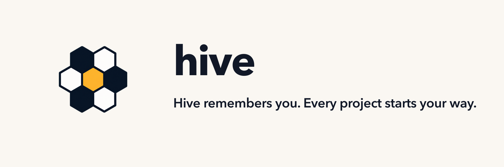

# Aigent Hive

<p align="center">
  
</p>

> A provider-neutral local harness for Codex, Claude Code (unverified), and Gemini Antigravity.

[](Cargo.toml)
[](rust-toolchain.toml)
[](LICENSE)

[English](./README.md) · [한국어](./docs/readme/README.ko.md)

<!-- AIGENT-HIVE:PUBLIC-STABLE version=0.16.1 release-date=2026-11-26 -->

Hive gives the AI coding apps you already use one consistent setup, project knowledge, Skill
routing, usage safeguards and safe updates. It never asks for model-provider API keys, never
calls model-provider APIs, and never replaces the app's own model runtime.

Stable `0.16.1` is the current public release. See
[GitHub Releases](https://github.com/gvm1229/aigent-hive/releases) for what changed in each version.

## Install the current stable release

```console
npm install -g aigent-hive@0.16.1
```

The npm installer needs Node.js and npm. The installed `hive` is a native binary and needs neither.
Without npm, use the direct installer for your shell:

```sh
# macOS and Linux
curl --proto '=https' --tlsv1.2 -LsSf https://unpkg.com/aigent-hive@0.16.1/install.sh | sh
```

```powershell
# Windows PowerShell 5.1+
irm https://unpkg.com/aigent-hive@0.16.1/install.ps1 | iex
```

```bat
:: Windows Command Prompt
curl.exe -fLo install-aigent-hive.cmd https://unpkg.com/aigent-hive@0.16.1/install.cmd && install-aigent-hive.cmd
```

Direct installers verify the package's exact-version SHA-256 and do not need npm, Node.js or
PowerShell 7. `hive --version` then prints:

```text
AIgent Hive v0.16.1 (released 2026-11-26)
```

## First setup

1. Run `hive update` in an interactive terminal, choose your AI apps, and answer the setup
   questions. Hive previews its changes before applying them and does not touch any project.
2. Open a project in your AI app and paste this prompt once per project:

   ```text
   Configure the local Aigent Hive harness for this project. Use my existing global Hive preferences, inspect only this project, show the exact write preview, and ask me only about choices that require my approval.
   ```

   If the app is not open in the project, replace "this project" with an absolute project path.
   Cancelling a question is not consent, and this prompt does not authorize an update, an optional
   third-party Skill or provider-credential access.

<details>
<summary>Optional: let your AI app do the whole user-level install</summary>

```text
I want the optional one-prompt Aigent Hive setup. Work only at user scope; do not inspect,
initialize, or change any project, repository, folder, or current working directory.

Install the current stable release 0.16.1. The stable install guidance is
https://github.com/gvm1229/aigent-hive#install-the-current-stable-release.
Detect my operating system and active host (Codex, Claude Code, or Gemini Antigravity), asking
me if either is unclear. Check whether Node.js and npm are available. If they are missing,
give me the official OS-specific Node.js installation command and request any approval the host
requires before installing it. Then install the exact Hive release I selected using the official
method in the linked guidance, verify `hive --version`, then run `hive update` once and select
the active host when prompted.

Then begin interactive global setup in this conversation. For a first setup, ask only whether I
want English or Korean first; continue one question at a time. For existing settings, first ask
whether I want to change one setting or review everything. Do not start project setup afterward:
offer the separate project-setup prompt instead. Never ask for provider API credentials or install
an optional third-party Skill.
```

</details>

## Update

Run `hive update` in an interactive terminal. It checks for a newer version, shows the exact
update and installs only after you accept. Declining, closing input or running
non-interactively installs nothing. Hive never updates silently, and it first copies your settings
and the files it will change to `~/hive-backups`.

Commands print readable Korean or English. Add `--output json` only when a program reads the result.

## Move global knowledge to another computer

`--user-root` is your home directory, not its `.hive` folder. Bundles hold portable canonical
knowledge only: no search index, runtime state, project-private knowledge, credentials or
absolute paths. On the other computer, confirm the SHA-256 matches the one printed at export,
then run `--dry-run`. Run `--apply` only if the dry run reports no conflict or validation error.

```sh
# macOS and Linux, on this computer: export
hive knowledge export --user-root "$HOME" --scope global --bundle "$HOME/Downloads/hive.hivekb"
shasum -a 256 "$HOME/Downloads/hive.hivekb"
# On the other computer: verify, preview, apply
shasum -a 256 "$HOME/Downloads/hive.hivekb"
hive knowledge import --user-root "$HOME" --bundle "$HOME/Downloads/hive.hivekb" --dry-run
hive knowledge import --user-root "$HOME" --bundle "$HOME/Downloads/hive.hivekb" --apply
```

```powershell
# Windows PowerShell, on this computer: export
hive knowledge export --user-root $env:USERPROFILE --scope global --bundle "$env:USERPROFILE\Downloads\hive.hivekb"
Get-FileHash -Algorithm SHA256 "$env:USERPROFILE\Downloads\hive.hivekb"
# On the other computer: verify, preview, apply
Get-FileHash -Algorithm SHA256 "$env:USERPROFILE\Downloads\hive.hivekb"
hive knowledge import --user-root $env:USERPROFILE --bundle "$env:USERPROFILE\Downloads\hive.hivekb" --dry-run
hive knowledge import --user-root $env:USERPROFILE --bundle "$env:USERPROFILE\Downloads\hive.hivekb" --apply
```

## Automatic dispatch safeguard

Automatic worker execution is off, and this release has no way to turn it on. When usage
protection is enabled, this preflight runs before any new automatic dispatch; it never
authorizes dispatch by itself. Ordinary answers and manual work do not run it:

```console
hive usage enforce --target <project> --session-id <id> --process-id <pid> --output json
```

## Gemini Antigravity support

Hive works with Gemini Antigravity in a narrower way than with Codex and Claude Code.

- **What works:** Hive installs its Skills and instructions into Antigravity. You then use `agy`
  or the Antigravity app yourself, just like the other apps, and Hive reads the usage numbers that
  Antigravity sends on its own.
- **What Hive never does with Antigravity:** start it or steer it by itself. That means no handing
  it a task as a worker, no using it to review or judge another app's work, no overnight loops,
  and no automatic restarts. Codex and Claude Code can do these jobs because their own official
  command-line and hook features allow it.
- **Why:** Google's [Antigravity FAQ](https://antigravity.google/docs/faq/) says that using third-party software to access
  Antigravity breaks its terms and can get the account suspended or closed. If Hive drove `agy`,
  Hive would be that third-party software. People have reported suspensions after a single use
  from another tool, and appeals are limited. Hive refuses these jobs so your Google account stays
  safe; it does not depend on any setting you could switch on by mistake.
- **Gemini models in other tools:** Google points third-party tools to a Gemini Enterprise or
  Google AI Studio API key instead. Hive never asks for or stores model-provider API keys, so it
  does not offer that route.

## Supported platforms

macOS (Apple Silicon, Intel), Linux (x86_64, arm64) and Windows x86_64. Public test acceptance
covers macOS Apple Silicon, Linux x86_64 and Windows x86_64; macOS Intel and Linux arm64 are
candidate-qualified only. Real app updates were checked on one Windows 11 PC; Codex runs were not
checked and Claude Code subscription behaviour is unverified. macOS builds use ad-hoc signing, and
Windows builds are unsigned unless SignPath Foundation signing is approved; see the
[code signing policy](./docs/guides/code-signing-policy.md).

## What Hive owns

Hive changes only its own marker blocks and manifest-listed files, keeps knowledge as
Markdown/YAML/TOML text, and treats SQLite indexes as rebuildable. It never owns provider
credentials, model sessions, other tools' guidance, or optional third-party Skills without
your approval.

## Documentation

- [Documentation home](./docs/00-home.md) · [Document index](./docs/01-index.md)
- [Product overview](./docs/overview/product.md) · [Development](./docs/guides/development.md)

Development needs Rust stable and Python 3.13, plus PowerShell 7 on Windows; run `python scripts/dev-check.py pre-push`
before pushing.

## QA Contributors

| Name | GitHub | Tested platform or area |
| --- | --- | --- |
| 안희준 | [No-Jyun](https://github.com/No-Jyun) | Windows x64 installation and configuration verification |

## License

Apache-2.0. See [LICENSE](./LICENSE).
