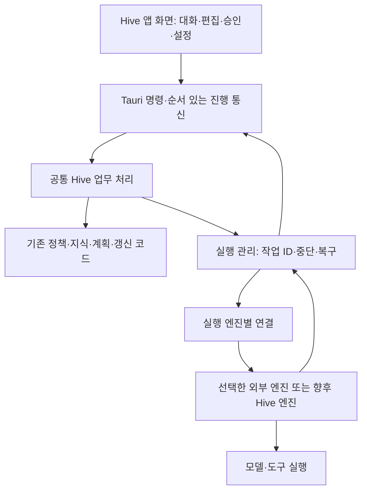

# 실행 엔진과 앱 구조

## 서로 다른 두 목표

| 목표 | Hive 책임 | 외부 책임 | 변경량 |
| --- | --- | --- | --- |
| 연결형 Hive Desktop | 화면·지식·계획·승인 연결·작업 관리·복구 | 선택한 엔진의 모델 호출·문맥·도구 실행 | 상당한 앱·실행 관리 개발 |
| 자체 실행 엔진의 Hive Desktop | 위 기능과 모델 요청·문맥 압축·도구 선택·실행·인증·비용 | 모델 제공 서비스 또는 선택한 로컬 모델 | 새 에이전트 제품의 개발 |

둘 다 사용자가 터미널 없이 쓰는 완전한 앱으로 구성 가능. 내부 보조 실행파일의 사용과 CLI 사용자 경험의 구분. 외부 엔진 연결만으로 Hive 자체 에이전트 실행 엔진 완성이라는 주장 제외.

에이전트 실행 반복: 요청→모델 판단→도구 실행→결과 전달→다음 판단의 순환. 현재 Hive의 완료 조건·재시도 상태 기계와 이 모델 실행 반복의 구분.

## 엔진 후보의 실제 조건

| 후보 | 공식 확인 | Hive 적용 조건 |
| --- | --- | --- |
| Codex App Server | 대화 시작·재개, 답변 조각, 도구·파일 승인, 중단, 계정·사용량의 JSON 통신 | 시작·대화·승인·중단·복구의 새 연결 계층, 인증·배포 범위 확인 |
| Claude Agent SDK | Claude Code의 도구·실행 반복·문맥 관리, Python·TypeScript 제공 | API 인증 또는 별도 Anthropic 승인, Hive 정책 개정, Node.js/Python 보조 실행파일 |
| Hermes 엔진 | Python의 모델·도구·문맥·저장 구현; 공식 데스크톱은 Electron·React와 별도 `hermes serve` 연결 | Python 배포·엔진 구성·정책 연결, SQLite 중심 저장과 Hive 정본 규칙의 조정 |
| Hive 자체 엔진 | 현재 저장소에 해당 모델 실행 반복의 구현 근거 부재 | 모델 연결·도구·문맥·인증·비용·시험 전체의 추가 |

Codex: [App Server](https://learn.chatgpt.com/docs/app-server). 문서상 App Server 명령과 WebSocket 통신의 실험 단계·운영 작업 지원 제한. 첫 검증 후보로만 사용, 운영용 확정 전 지원 상태·고정 버전 시험 필요. 기존 로컬·오픈소스 앱의 인증 계속 사용 설명과 상용·호스팅 서비스의 동일 인증 경로 불허 확인; 신규 Hive 앱의 허용 범위는 별도 확인. [Sign in with ChatGPT](https://developers.openai.com/siwc/token-sharing-open-source)는 대안 후보지만 앱의 인증 관리 책임·미리 보기 제한 검토 필요.

Claude: [SDK 설명](https://code.claude.com/docs/en/agent-sdk/overview), [인증 조건](https://code.claude.com/docs/en/agent-sdk/quickstart). 사전 승인 없는 제삼자 제품의 `claude.ai` 로그인·사용량 한도 제공 불허. 기존 구독을 그대로 별도 Hive 앱에 붙이는 기본 경로 제외. [Max·Team의 API 크레딧](https://platform.claude.com/docs/en/about-claude/api-credits-for-subscribers)과 Claude Code 구독 사용량의 별도 구분. 현재 Hive의 API 자격 증명 금지와 API 기반 SDK 도입의 충돌; 이번 조사에서 인증 정보 요청 없음.

Hermes: [데스크톱 구조](https://hermes-agent.nousresearch.com/docs/user-guide/desktop), [엔진 구조](https://hermes-agent.nousresearch.com/docs/developer-guide/architecture), [공개 저장소](https://github.com/NousResearch/hermes-agent)의 MIT 표시 확인. 가장 직접적인 제품 구조 참고 사례. 핵심 코드의 무조건 복사보다 화면·실행 분리 원칙과 기능별 구현 경계 참고. 코드 라이선스·종속 패키지·브랜드·모델 서비스의 사용 조건은 별도 항목.

## 추천 구조



- 화면: 입력·표시·승인 결과 전달. 임의 파일 접근·임의 명령 실행·제공자 인증 정보 소유 제외
- 업무 처리: 현재 경로·승인·지식·설정 검증과 결과형의 소유
- 실행 관리: 명시적 엔진·작업 ID, 지속 연결, 요청 순서, 중단, 복구, 상태 검증
- 엔진: 모델 판단과 실행 도구의 실제 호출; 엔진별 능력 검증과 증거 필요
- 통신: 첫 로컬 앱은 표준 입출력 우선. 앱에서 외부 엔진과 직접 HTTP 모델 통신하는 동작의 자동 추가 제외
- 기본 격리: 화면 프로세스와 실행 생명주기의 분리. 창 다시 열기로 새 작업 중복 실행 방지
- Git·터미널: 명시적 프로젝트 폴더와 인자 배열, 입력·출력 제한. 화면 입력을 셸 명령 문자열로 바로 실행하는 경로 제외

Tauri 권한 제한은 화면의 시스템 접근 제한 기능. 실행 엔진이 수행하는 셸 명령의 운영체제 격리까지 자동 제공하는 기능과의 구분. [Capabilities의 보호 범위](https://v2.tauri.app/security/capabilities/). Windows·macOS·Linux별 도구 실행 환경의 실제 제한·중단·경로 이탈 시험 필요.

## 공통 연결 규약의 초안

아래 이름은 새 설계 후보. 기존 Hive API와의 구분.

```text
EngineCapabilities {
  protocol_version, backend_id, authentication_modes,
  stream, approval, interrupt, resume, subagents, sandbox
}

StartTurn { operation_id, session_id, project_id, engine_id, input }
EngineEvent { schema_version, session_id, turn_id, sequence, kind, payload }
ApprovalReply { request_id, turn_id, decision, scope }
CancelTurn { session_id, turn_id }
```

- 시작: 작업 ID 기록→실행 요청→네이티브 작업 ID 확인→진행 상태
- 취소: 취소 요청과 실제 중단 확인의 분리; 요청 수락만으로 중단 완료 표시 금지
- 연결 끊김: 실행 여부 불명확 상태 보존, 원래 작업 ID 조회·재개 우선; 즉시 재실행 금지
- 진행: 답변 조각을 모아 전달, 화면의 속도에 맞춘 흐름 제한, 순서 번호·크기 상한
- 승인: 실제 요청 ID·파일·명령·범위·기한에 결속; 오래된 창의 승인 거부
- 증거: 일반 엔진 응답을 서명된 Hive 승인·`HostReceipt`와 동일 취급 금지. 각 연결의 증거 생성·검증 계약 별도
- 비용: 구독 잔여량·실제 모델 토큰·API 요금의 분리. 모델별 요금·계정 한도 미확인 값을 `0`으로 표시하는 처리 제외

## 도구·저장·호환성

- [MCP](https://modelcontextprotocol.io/docs/2026-07-28/getting-started/intro): AI와 외부 도구·자료의 연결 규약. 에이전트 실행 엔진의 대체물과의 구분
- [ACP](https://agentclientprotocol.com/get-started/introduction): 앱·편집기와 에이전트의 통신 후보. 로컬 표준 입출력·JSON-RPC 중심, 원격 지원 개발 중. 모든 엔진의 완전한 공통 지원 가정 제외
- Codex·Claude의 기존 앱에 보이는 브라우저·음성·플러그인·연결 서비스 전체의 자동 이전 가정 제외. 엔진별 실제 제공 기능만 화면에 노출
- Hive 지식·역할·계획·완료 근거의 Markdown 정본 유지. SQLite에는 재생성 가능한 검색·표시용 색인만 배치
- 대화 기록·파일 첨부·인증은 지식 자동 수집과 분리한 사용자 비공개 운영 자료. 저장 위치·보존 기간·삭제·가져오기 권한의 별도 설계
- 외부 엔진이 자체 기록을 보관하는 경우 소유자·위치만 연결. Hive 지식 정본으로 무차별 복사 금지
- 기존 플러그인 설치와 새 앱의 공존, 실행 엔진 버전·프로토콜 버전과 앱의 호환 표 필요
