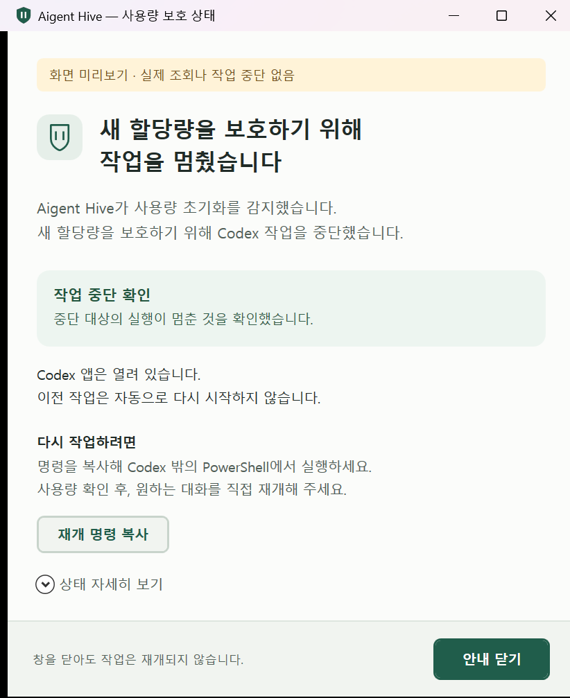

# 최종 사용자용 중단 안내 창 0.12.1

## 표시와 동작

- 실제 사용자에게도 나타나는 별도 Windows 안내 창. 중단된 모델의 마지막 답변이나 도구 호출에 의존하지 않는 표시
- 첫 화면의 Hive 보호 동작·중단 원인·확인 상태·Codex 앱 유지·자동 재개 부재·재개 방법. 감지 시각과 자세한 수치는 펼친 상세 영역
- 실제 제품의 시험 문구 제외. 표시 전용 미리보기와 실제 합성 초기화 사건의 서로 다른 표식
- 초기화와 60초 사용량 조회 공백의 이유 구분. 미확인·읽기 오류·새 사건을 완료로 표시하지 않는 경계
- 닫기는 안내 창만 닫는 동작. 사건 확인·사용량 조회·보호 해제·작업 재개 없음
- 사건의 명시 확인·새 사용량 조회 뒤에도 원래 이유 보존, 원하는 대화에서 사용자의 직접 재개

## 구현

- `usage_monitor/notice.ps1`: WPF 기본 창·상태 계산·1초 표시 갱신. 장치 독립 크기·줄바꿈·스크롤·키보드 Esc 경로·접근성 이름
- `platform.rs::notify`: 별도 표시 과정과 5초 표시 확인. 표시 실패 때 간단한 Windows 안내 대체, 중단 제어부의 표시 대기 없음
- `windows.ps1`: 앱 신원 조회와 예약 작업 제어만 유지. 안내 파일 분리로 Windows 실행 인수 크기의 여유 확보
- 색·글꼴: 밝은 바탕·진한 한국어 시스템 글꼴, 확인 완료의 초록과 확인 필요의 갈색. 색에 더한 상태 문구

## 현재 Windows 검증

- [표시 근거](../../tests/results/usage-stop-notice-windows-0.12.1.json)·[관련 회귀·빌드](../../tests/results/runs/20261017T194918-9e5c6b2382ed.md)·[최종 표시·문구 회귀](../../tests/results/runs/20261017T195433-f03309a58f0e.md)
- Windows 11 x64·현재 Codex 26.1013.4894.0, 실제 144 DPI·150% 화면 배율. 560/460 장치 독립 폭의 성공·조회 실패·부분 확인·기록 확인·읽기 실패 표시
- 제품과 같은 고정 UTF-8 시작 경로의 실제 안내 진입 875ms. Windows 접근성 기능으로 해당 안내의 닫기 버튼 실행, 사건 파일 바이트·원래 Codex 앱 신원·창 유지
- Esc 이벤트 경로와 닫기 버튼의 사건 보존, 11개 문구·상태 회귀. Windows 어댑터 30개·Rust 감시기 25개·엄격 Clippy·개발 빌드 통과
- Rust의 실제 센서 관측 1개는 기본 제외, 이전 별도 실제 관측 근거와 구분. 실제 키보드 입력·96/192 DPI·다른 OS 미실행, 해당 범위의 증명 제외
- 이번 표시 검증의 사용량 조회·감시 활성화·세션 중단·설치 없음. 이전 두 실제 중단 시험과 별도, 전체 자동 확인 미완료를 설치 완료로 바꾸는 처리 없음

## 남은 범위

- [전체 세션 중단 근거](session-stop-0.12.1.md)의 자동 확인 1건 보정과 설치 수용. 추가 실제 중단 시험 없이 읽기 전용 관측·행동 회귀 우선
- 현재 사용자 CLI 0.12.0·전역 감시 비활성, 정식 0.12.1 게시·설치 완료 주장 없음
