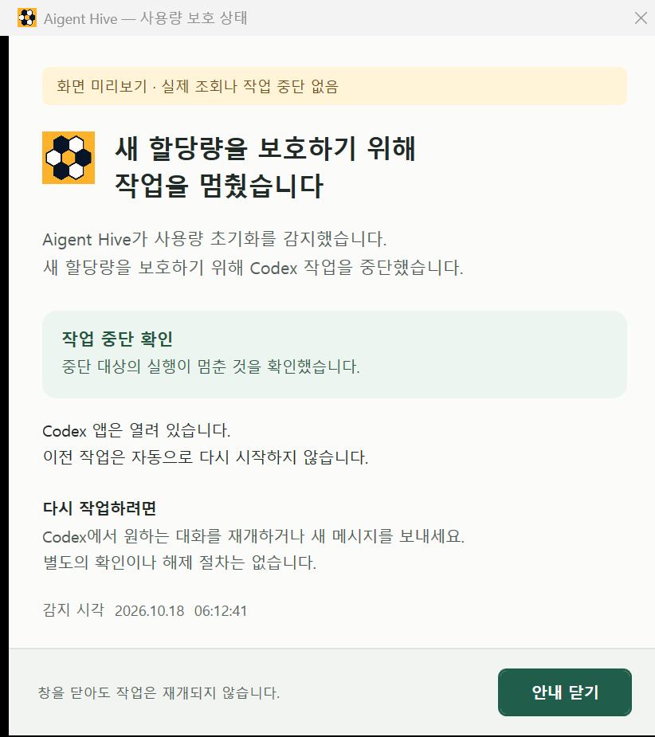

# 사용량 중단 알림 창 0.12.1

## 최종 동작

- 사용자 목적: 갑자기 멈춘 대화가 Codex 오류가 아닌 Hive 사용량 감지에 따른 중단임을 알리는 안내
- 공식 로고 원본: `harness/plugins/aigent-hive/assets/hive-logo-plugin.png`. 원본 바이트를 제품에 포함, 제목 아이콘과 본문에 같은 이미지 사용
- 첫 화면: Hive가 멈춘 이유·실제 중단 확인 결과·앱 유지·감지 시각·Codex 직접 재개 방법
- 닫기 버튼 하나만 제공. 명령 복사·잠금·해제·사용량 확인·작업 재개 기능 없음. 닫기와 Esc는 창만 닫는 동작
- Codex에서 사용자의 재개 또는 새 메시지로 계속 진행. 이전 작업의 자동 재개 없음
- 초기화와 60초 사용량 조회 공백의 서로 다른 이유. 일부 확인·읽기 실패·지난 기록을 전체 중단 성공으로 표시하지 않는 경계
- 실제 제품의 시험 표식 없음. 표시 전용 미리보기와 합성 초기화 시험에는 각각의 표식

## 구현과 검증

- `notice.ps1`: 별도 Windows WPF 창, 1초 상태 갱신·줄바꿈·좁은 폭·스크롤·키보드 초점·접근성 이름
- `platform.rs::notify`: 고정 UTF-8 시작 코드와 표준 입력의 공식 로고 전달, 5초 표시 확인. 안내 처리와 중단 제어의 독립 실행
- [현재 Windows 근거](../../tests/results/usage-stop-notice-only-windows-0.12.1.json): Windows 11 x64·Codex 26.1013.4894.0, 실제 144 DPI·150% 배율의 560/460 폭. 현재 진입 812ms
- 상태·문구·공식 로고·닫기 단일 동작 13개 회귀와 실제 표시 진입·접근성 닫기 통과. 사건 파일 바이트·원래 Codex 앱 창 유지, 새 실제 중단 요청 없음
- 실제 키보드 입력·96/192 DPI·다른 운영체제 미실행. Esc 이벤트 경로와 현재 Windows 표시의 증명, 실제 할당량 초기화의 증명 제외
- 이전 명령 복사형 화면은 [이전 근거](../../tests/results/usage-stop-notice-windows-0.12.1.json)로 보존, 최종 제품 동작과 구분
- [최종 설치](../../tests/results/session-stop-one-shot-installation-0.12.1.json): 0.12.1-dev 로컬 설치·정본 보존·로그인 자동 시작·실제 정상 관측 확인. 공개 안정판 게시 별도

